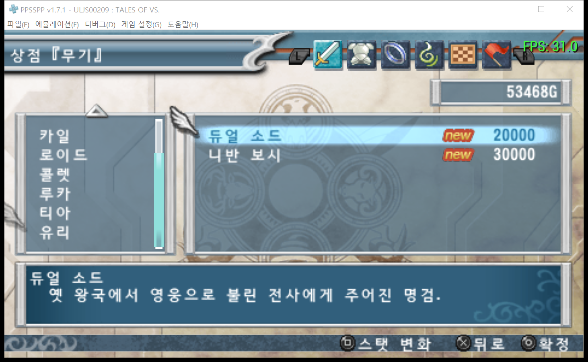

# 테일즈 오브 버서스 한국어 패치

PSP 일본판 **TALES OF VS. (ULJS00209)**의 비공식 한국어 팬 번역 패치입니다.

**한글패치: 라그나로크 쿄이치**

---

## 🚀 최신 한글패치 v0.9 (2026.10.31 배포)

> **[📥 최신 v0.9 패치 파일(TALES_OF_VS_KO_v0.9.xdelta) 직접 다운로드](https://github.com/kyose-ragkyoichi/tales-of-vs-korean-patch/releases/download/v0.9/TALES_OF_VS_KO_v0.9.xdelta)**  
> 🔗 **[v0.9 GitHub 릴리스 페이지 바로가기](https://github.com/kyose-ragkyoichi/tales-of-vs-korean-patch/releases/tag/v0.9)**

### [패치 정보]
* **패치 파일**: TALES_OF_VS_KO_v0.9.xdelta (938,996 바이트)
* **대상 원본 ISO**: 일본판 『TALES OF VS.』(ULJS00209)
  * 크기: 790,265,856 바이트
  * 원본 SHA-256: 236B8BD39B99C55CD61351BE829B28C9DBF3D0987F14982B1221D66484A76C06
* **패치 적용 후 ISO**:
  * 크기: 790,265,856 바이트
  * 패치본 SHA-256: B4430E5C06C7E94EBD293686AC6BAE8B64D46DC751DBEF53B1DA0E788EF79E08

### [한글화 완성도 현황 (체감 완성도 약 97~98%)]

| 구분 | 완성도 | 상태 및 세부 내용 |
| :--- | :---: | :--- |
| **메인 스토리 스킷** | **100%** | 총 **8,207행** 전 행 번역 완료 (일본어 원문 1:1 대조로 오역/말투/루크·루카 구분 등 1,509행 전면 수정) |
| **서브 퀘스트 스킷** | **100%** | 총 **1,189행** 전 행 번역 완료 (원문 대조 및 97행 교정 완료) |
| **시스템·메뉴·도감·크레딧** | **100%** | 총 **8,314행** 전 행 번역 완료 (칭호/장비 획득 메시지 ↔ 도감/상점 명칭 1:1 동기화 등 1,030행 수정) |
| **한글 폰트 엔진** | **100%** | 14px 한글 비례 폰트 메트릭 최적화로 글자 뭉개짐 없이 전 대사 가독성 완벽 지원 |
| **그래픽 UI / 텍스처** | **약 95%** | 타이틀 로고, PRESS START, 저작권, 모드 선택, 대전 HUD, 21인 전 캐릭터 비오의 컷인, 튜토리얼(1~5) 등 70여 개 그래픽 파일 패치 완료 (월 브레이커 일부 특수 연출 미세 그래픽 제외) |
| **오프닝/영상(PMF) 및 음성** | **-** | 영상 속 일본어 타이포그래피 및 캐릭터 음성은 테일즈 시리즈 전통대로 일본어 오리지널 원본 보존 |

> **💡 플레이 체감 안내**: 게임 시작부터 메인 스토리 완결, 서브 퀘스트, 테일즈 도감 및 칭호 수집, 대전 모드까지 **언어적 장벽 없이 쾌적하게 100% 한글로 플레이**하실 수 있는 사실상의 완전판 수준입니다.

### [0.89 버전 대비 0.9 버전 주요 개선 및 변경 내역]

총 **17,710행**의 원문을 1:1 전수 재대조하여 총 **2,636행**의 번역 및 오역, 표기를 전면 수정·보완하였습니다.

1. **스토리 및 대사 전면 검수 및 교정**
   - **스토리 스킷 전체 8,207행 원문 1:1 대조 및 1,509행 수정**: 원작 캐릭터의 말투와 뉘앙스, 오역 전면 수정.
   - **서브 스킷 1,189행 원문 대조 및 97행 수정**.
   - **인명 엄격 구분**: 루크(Luke)와 루카(Ruca)가 혼동되어 표기되던 문제 전면 분리 교정.
   - **문맥에 따른 번역 세분화**: 문맥과 캐릭터에 맞지 않던 획일적 직역(「甘い」 → 무르다, 어설프다, 녹록지 않다 등 문맥별 교정).
   - 화자 이름 표기 전각 콜론(：) 일관 통일.

2. **메뉴, 도감, 칭호 및 장비 1:1 동기화 (1,030행 수정)**
   - **시스템/메뉴/도감 텍스트 총 8,314행 전수 대조 완료**.
   - **명칭 불일치 완벽 해결**: 전투 후 칭호나 무기를 얻었을 때 표시되는 획득 메시지와 실제 도감/상점/장비 목록에서의 명칭이 달라 혼란을 주던 항목 전수 동기화.
   - **장비/아이템 규격 통일**: 세계수의 나뭇가지, 앤디스의 찻집, 대결의 대검, 가죽 투구/가죽투구/가죽모자 등 띄어쓰기 및 명칭 규격 통일.

3. **세계관 용어 및 고유명사 공식 표기 통일**
   - **지역 및 설정 용어**: 시글루스, 큰 결실, 삼여신(스컬드·베르단디·우르즈) 깃발, 신성제국(디이즈), 프레스버그, 렐라리즈, 세계수의 무녀, 하비뮤, 콩맨, 세아라프참, 핫센 배려, 다르타로스, 펜디트, 대포, 제작체, 마테오, 다이로크, 리츠츠, 레즈넥, 에리트, 파브니, 류장 등 시리즈 공식 명칭으로 통일.
   - **조사 오류 자동 보정**: '깃발' 관련 조사(을/를, 이/가) 오적용 교정.

4. **인물명 및 제작진 표기 정리**
   - 민트 아데네이드, 프리드 세리우스, 카일 듀나미스, 프레세아 콤바티어, 리아 그레츠, 리히터 아벤트 등 공식/통일 표기 반영.
   - 엔딩 크레딧 제작진 직책 표기(서브 프로그래머 등) 및 회사명(주식회사 온쿄 하우스 등) 규격 일괄 정돈.

5. **폰트 가독성 및 게임 구동 무결성 검증**
   - 원본 14px 비례 폰트 메트릭을 유지하여 글자 뭉개짐이나 왜곡 없는 최적의 가독성 구현.
   - 제어 코드, 줄바꿈, 선행 전각 공백 구조 검증 오류 0건 완료.
   - 실기 에뮬레이터(PPSSPP) 환경에서 인게임 화면 렌더링 및 대사 출력 검증 완료.

| v0.9 인게임 상점/메뉴 폰트 렌더링 검증 화면 |
| :---: |
|  |

---

## 이전 버전: v0.89

[한글패치 v0.89 다운로드 및 상세 안내](https://github.com/kyose-ragkyoichi/tales-of-vs-korean-patch/releases/tag/v0.89)

스토리, 스킷, 메뉴, 도감과 월 브레이커의 텍스트 및 일부 이미지를 한국어로 번역했습니다.

## 스크린샷

| 타이틀 | 모드 선택 |
| :---: | :---: |
|  |  |
| 월 브레이커 | 월 브레이커 캐릭터 선택 |
|  |  |
| 크레딧 | 테일즈 도감 |
|  |  |
| 대전 캐릭터 선택 | |
|  | |

## 적용 방법

1. 직접 보유한 PSP 일본판 원본 ISO와 xdelta 패치 프로그램을 준비합니다.
2. [최신 v0.9 패치 다운로드](https://github.com/kyose-ragkyoichi/tales-of-vs-korean-patch/releases/download/v0.9/TALES_OF_VS_KO_v0.9.xdelta) (또는 [v0.89 릴리스](https://github.com/kyose-ragkyoichi/tales-of-vs-korean-patch/releases/tag/v0.89))에서 xdelta 파일을 받습니다.
3. Delta Patcher 또는 xdeltaUI에서 원본 ISO와 패치 파일을 선택해 새 ISO를 생성합니다.
4. PPSSPP 또는 사용자 환경에 맞는 PSP에서 생성한 ISO를 실행합니다.

* 원본 ISO 크기: **790,265,856 바이트**  
* 원본 ISO SHA-256: 236B8BD39B99C55CD61351BE829B28C9DBF3D0987F14982B1221D66484A76C06

## 패치 이용 안내

- 이 패치는 직접 보유한 일본판 게임용으로 제작되었습니다. 다른 지역판이나 덤프에는 적용되지 않을 수 있으니 위의 원본 해시를 확인해 주세요.
- 배포물은 xdelta 패치이며, 게임 ISO는 제공하지 않습니다. 본인이 적법하게 보유한 원본에 적용해 주세요.
- 번역, 문장 정리, 데이터 분석 및 패치 제작에는 AI가 활용되었습니다. 전체 검수 작업을 진행하였으나 플레이 상황에 따라 일부 오역이나 어색한 표현이 남아 있을 수 있습니다.
- 기기나 진행 상황에 따라 표시 오류, 멈춤 또는 진행 문제가 발생할 수 있습니다. 적용 전에 **원본 ISO와 세이브 데이터**를 백업해 주세요.
- 특정 구간에서 진행이 막힌다면 원본 게임으로 그 구간을 통과해 저장한 뒤 패치판에서 이어가는 방법을 시도할 수 있습니다. 단, 세이브 호환성은 환경에 따라 다를 수 있습니다.
- 오류를 제보할 때는 패치 버전, 발생 장소와 상황, 기기 또는 에뮬레이터, 가능한 경우 화면 사진을 [Issues](https://github.com/kyose-ragkyoichi/tales-of-vs-korean-patch/issues)에 남겨 주세요. 개인정보가 들어 있는 자료는 공개 전에 확인해 주세요.
- 일부 월 브레이커 이미지와 작은 대사, 실기 환경의 전체 동작은 아직 검증이 완료되지 않았으며 영상 속 글자 등 일부 원문이 남아 있을 수 있습니다.
- 비공식 팬 프로젝트로 원작사 및 권리자와 관련이 없습니다. 게임과 캐릭터의 권리는 각 권리자에게 있습니다. 패치의 상업적 이용과 무단 재배포를 삼가 주세요.
- 권리자로부터 요청이 있을 경우 공개 내용은 수정되거나 내려갈 수 있습니다. 권리 관련 문의는 Issues로 알려 주세요.