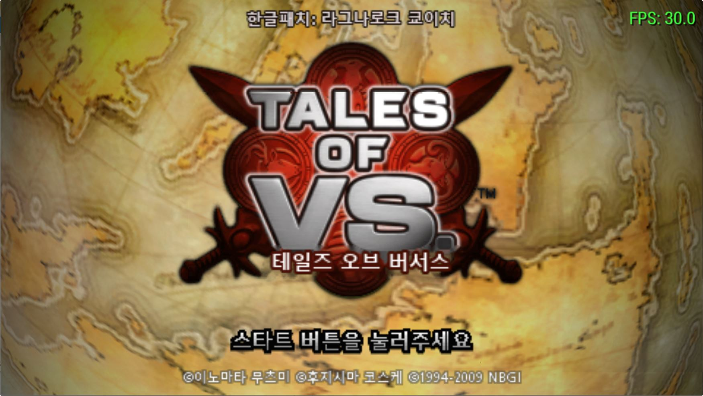
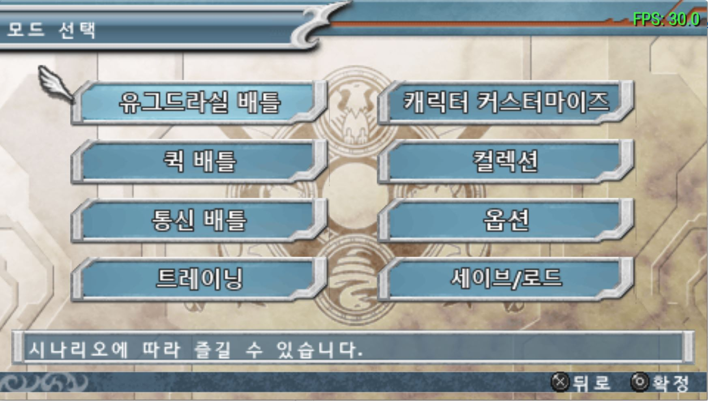
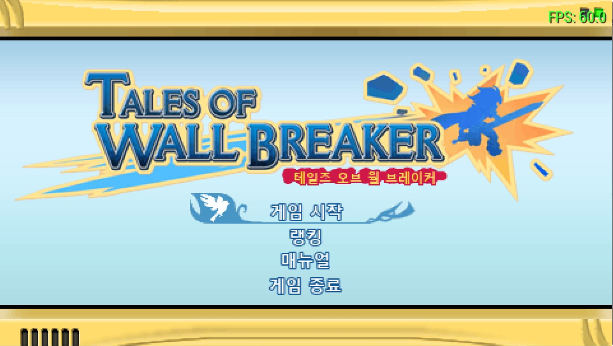
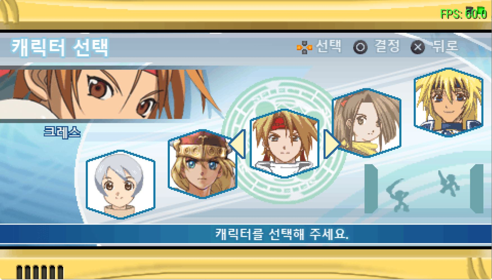
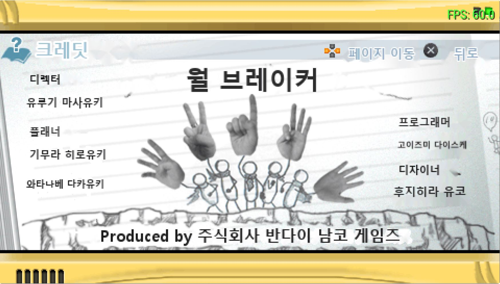
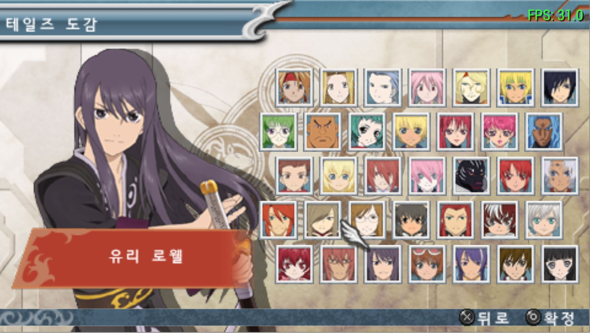
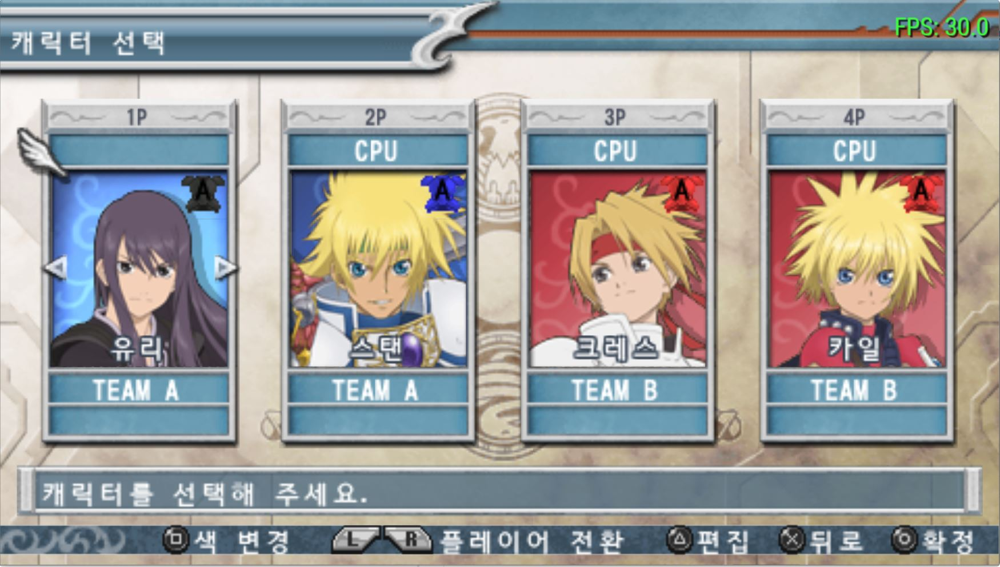

# 테일즈 오브 버서스 한국어 패치

PSP 일본판 **TALES OF VS. (ULJS00209)**의 비공식 한국어 팬 번역 패치입니다.

**한글패치: 라그나로크 쿄이치**

## 다운로드

[한글패치 v0.89 다운로드 및 상세 안내](https://github.com/kyose-ragkyoichi/tales-of-vs-korean-patch/releases/tag/v0.89)

스토리, 스킷, 메뉴, 도감과 월 브레이커의 텍스트 및 일부 이미지를 한국어로 번역했습니다.

## 스크린샷

| 타이틀 | 모드 선택 |
| :---: | :---: |
|  |  |
| 월 브레이커 | 월 브레이커 캐릭터 선택 |
|  |  |
| 크레딧 | 테일즈 도감 |
|  |  |
| 대전 캐릭터 선택 | |
|  | |

## 적용 방법

1. 직접 보유한 PSP 일본판 원본 ISO와 xdelta 패치 프로그램을 준비합니다.
2. [v0.89 릴리스](https://github.com/kyose-ragkyoichi/tales-of-vs-korean-patch/releases/tag/v0.89)의 Assets에서 xdelta 파일을 받습니다.
3. Delta Patcher 또는 xdeltaUI에서 원본 ISO와 패치 파일을 선택해 새 ISO를 생성합니다.
4. PPSSPP 또는 사용자 환경에 맞는 PSP에서 생성한 ISO를 실행합니다.

원본 ISO 크기: **790,265,856 바이트**  
원본 ISO SHA-256: `236B8BD39B99C55CD61351BE829B28C9DBF3D0987F14982B1221D66484A76C06`

## 패치 이용 안내

- 이 패치는 직접 보유한 일본판 게임용으로 제작되었습니다. 다른 지역판이나 덤프에는 적용되지 않을 수 있으니 위의 원본 해시를 확인해 주세요.
- 배포물은 xdelta 패치이며, 게임 ISO는 제공하지 않습니다. 본인이 적법하게 보유한 원본에 적용해 주세요.
- 번역, 문장 정리, 데이터 분석 및 패치 제작에는 AI가 활용되었습니다. 일부는 사람이 확인했지만 전체 검수는 완료되지 않아 오역이나 어색한 표현이 남아 있을 수 있습니다.
- 기기나 진행 상황에 따라 표시 오류, 멈춤 또는 진행 문제가 발생할 수 있습니다. 적용 전에 **원본 ISO와 세이브 데이터**를 백업해 주세요.
- 특정 구간에서 진행이 막힌다면 원본 게임으로 그 구간을 통과해 저장한 뒤 패치판에서 이어가는 방법을 시도할 수 있습니다. 단, 세이브 호환성은 환경에 따라 다를 수 있습니다.
- 오류를 제보할 때는 패치 버전, 발생 장소와 상황, 기기 또는 에뮬레이터, 가능한 경우 화면 사진을 [Issues](https://github.com/kyose-ragkyoichi/tales-of-vs-korean-patch/issues)에 남겨 주세요. 개인정보가 들어 있는 자료는 공개 전에 확인해 주세요.
- 일부 월 브레이커 이미지와 작은 대사, 실기 환경의 전체 동작은 아직 검증이 완료되지 않았으며 영상 속 글자 등 일부 원문이 남아 있을 수 있습니다.
- 비공식 팬 프로젝트로 원작사 및 권리자와 관련이 없습니다. 게임과 캐릭터의 권리는 각 권리자에게 있습니다. 패치의 상업적 이용과 무단 재배포를 삼가 주세요.
- 권리자로부터 요청이 있을 경우 공개 내용은 수정되거나 내려갈 수 있습니다. 권리 관련 문의는 Issues로 알려 주세요.
